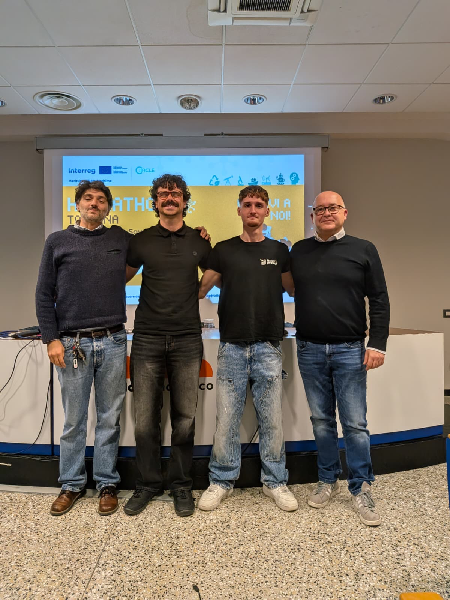
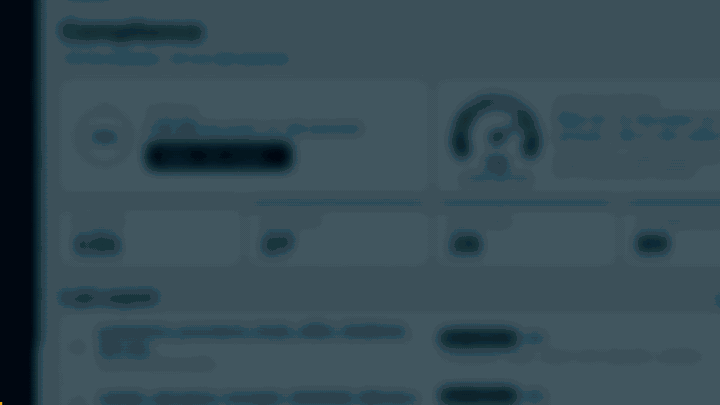

<p align="center">
  <picture>
    <source media="(prefers-color-scheme: dark)" srcset="asset/dago-logo-negativo.svg">
    
  </picture>
</p>

# DaGo, data governance in un click

DaGo legge i file nelle cartelle di rete di un Comune, trova i dati personali e dice per ognuno se è in regola con il registro dei trattamenti. L'abbiamo costruito in due giorni per la sfida 5 dell'Hackathon Toscana, "Governare il patrimonio informativo", proposta dal Comune di Livorno, vincendo il primo posto!



Il codice è quello scritto durante la gara, con i test, la documentazione e il pitch che abbiamo presentato alla giuria.

## Il problema

Un Comune capoluogo ha milioni di file sparsi tra cartelle condivise, archivi ed email. Dentro ci sono certificati medici, domande di sussidio, fascicoli del personale. Se una persona ci mettesse solo 30 secondi per capire cosa contiene un file e se è trattato come dice il registro, con quasi 5 milioni di file dovrebbe passare i prossimi 25 anni a fare solo quello, e al Comune costerebbe più di un milione di euro.

E per la PA la data governance è importantissima: un incidente informatico grave su quattro in Italia colpisce la pubblica amministrazione (Rapporto Clusit 2026). Se succede, il GDPR chiede di dire entro 72 ore quali dati sono coinvolti, e serve anche la loro scheda di trattamento.

## Cosa fa DaGo

Per ogni file DaGo:

1. estrae il testo da PDF, Word, Excel, ODT, email e CSV, con l'OCR per le scansioni;
2. trova i dati personali (codici fiscali, IBAN, email, telefoni, date di nascita) e le categorie particolari come salute o dati giudiziari;
3. propone le tre schede del registro dei trattamenti più adatte e spiega perché;
4. controlla le regole: categoria non dichiarata, accesso troppo largo alla cartella, conservazione scaduta, pubblicazione non prevista;
5. assegna l'esito: nessun dato personale, conforme, non conforme o scheda mancante.

Poi l'RPD (il responsabile della protezione dei dati) apre l'interfaccia web, vede i documenti ordinati per rischio e conferma o corregge. Ogni esito resta una proposta finché l'RPD non lo conferma.

Tutto gira dentro l'ente. I documenti non vanno su nessun cloud, e anche il modello linguistico per i casi dubbi è locale (Ollama) e facoltativo.

Ecco 20 secondi di demo (il video intero è in [`pitch/dago-demo.mp4`](pitch/dago-demo.mp4)):



## Quanto funziona

Il kit della sfida aveva 155 file di prova (tutti con dati sintetici ma verosimili) e un validation set da usare solo per misurare. Siamo partiti da 8,7 punti su 100 e siamo arrivati a 86,7 sul validation set con le etichette originali della giuria. Se si toglie il controllo sul luogo di archiviazione, che abbiamo scelto di non fare per motivi tecnici durante l'hackathon, il punteggio sale a 90,4.

Ogni passo è una pull request con il suo punteggio: la storia completa è in [`docs/roadmap.md`](docs/roadmap.md).

## Come provarlo

Servono Python 3.10 o più recente e, per le scansioni, `tesseract-ocr`, `tesseract-ocr-ita` e `ocrmypdf`. Senza OCR tutto il resto funziona lo stesso.

```bash
python -m venv .venv
.venv/bin/pip install -r requirements.txt -r requirements-ui.txt
make score                        # analizza i file di prova e stampa il punteggio
UI_ENTE="Comune di Livorno" .venv/bin/python -m ui   # apri http://127.0.0.1:8000
```

Per usare il modello locale sui casi dubbi: `make score LLM=qwen3:1.7b` (serve Ollama).

## Com'è fatto

| Cartella | Cosa c'è |
| --- | --- |
| `classifier/` | la pipeline: estrazione del testo, entità, categorie, abbinamento alle schede, regole, punteggio |
| `ui/` | l'interfaccia per l'RPD (FastAPI, accessibile secondo WCAG 2.1 AA) |
| `tests/` | 188 test, scritti prima del codice |
| `docs/` | roadmap, diario del progetto, diagrammi di flusso, threat model, brand kit |
| `data/` | il kit della sfida con i dati sintetici e le predizioni |
| `pitch/` | il pitch deck, il video della demo e la foto del team |

## Il pitch

In [`pitch/`](pitch/) trovi le slide che abbiamo presentato ([`pitch_deck.pptx`](pitch/pitch_deck.pptx), la [versione PDF](pitch/pitch_deck.pdf) e il video della demo). C'è tutto: il problema, il confronto con Microsoft Purview, BigID e Netwrix, il modello di business con un canone di circa 10 centesimi per abitante all'anno e il piano per partire dai Comuni toscani.

## Il team

- Sergio ([@sergiovzambelli](https://github.com/sergiovzambelli)), imprenditore tech
- Michele ([@michele702](https://github.com/michele702)), ITS Prodigi
- Tommaso, ITS Prodigi

Con Giacomo e Stefano come advisor, che lavorano sull'innovazione digitale nella PA e ci hanno aiutato a capire come ragiona un Comune.

## Grazie

Al Comune di Livorno per la sfida e per un kit di dati fatto davvero bene, agli organizzatori dell'Hackathon Toscana e del progetto CIIRCLE (Interreg Italia-Francia Marittimo), e alla giuria.
