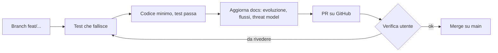

# Diagrammi di flusso

Diagrammi Mermaid, aggiornati a ogni PR che cambia un flusso. Segnare i confini di fiducia (es. browser → server).

## Flusso di sviluppo

## Flussi dell'applicazione

_Nessuno ancora._
