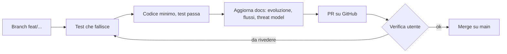
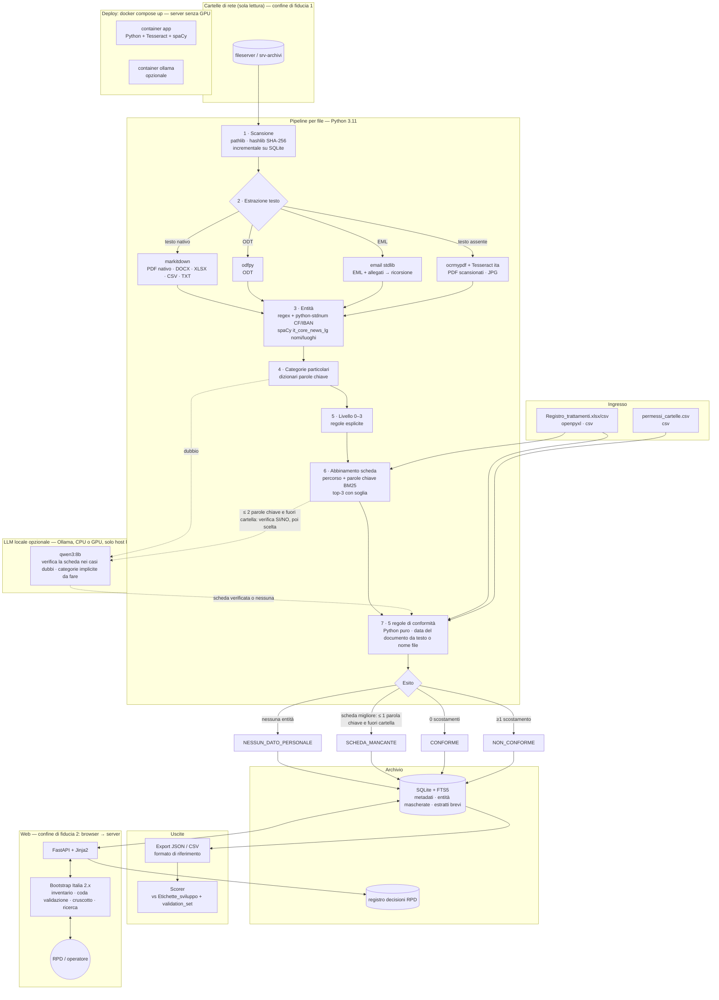
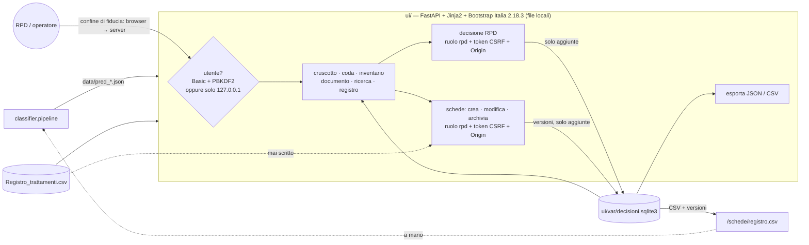
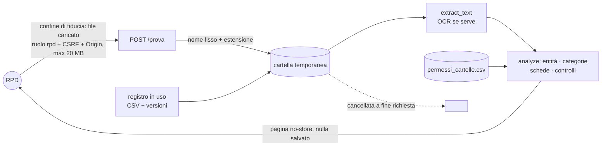
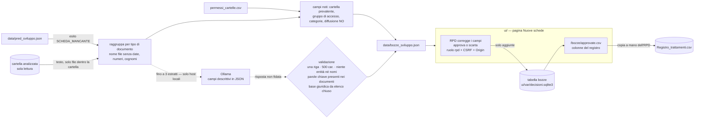

# Diagrammi di flusso

Diagrammi Mermaid, aggiornati a ogni PR che cambia un flusso. Segnare i confini di fiducia (es. browser → server).

## Flusso di sviluppo

## Flussi dell'applicazione

### Architettura e tool (proposta; implementati: Scansione senza incrementale, Estrazione testo con OCR (EML con allegati), Entità con regex, Categorie particolari con dizionari, Abbinamento scheda top-3 senza soglia, Export JSON, Scorer)

Tutto gratuito, open source, eseguito in locale senza Internet. Il LLM è opzionale: la catena funziona anche solo con le regole.

## Interfaccia web (ui/)

Dettagli in [ui.md](ui.md). La UI legge i file prodotti dal classificatore; solo la pagina "Prova un file" lo chiama direttamente (`classifier.pipeline.analyze`).

### Prova un file (feat/try-file)

## Bozze di nuove schede (feat/draft-records)

