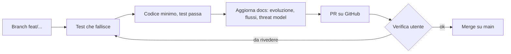
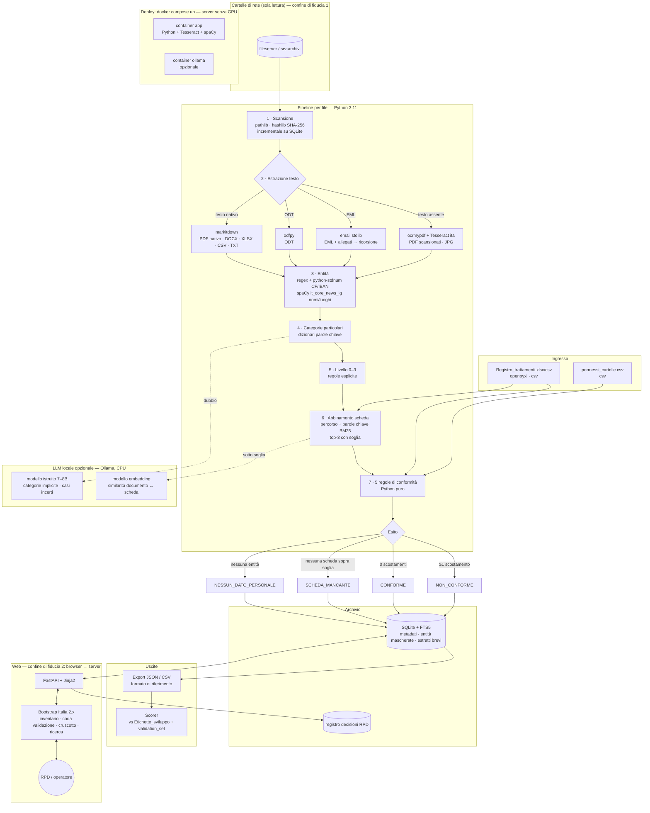

# Diagrammi di flusso

Diagrammi Mermaid, aggiornati a ogni PR che cambia un flusso. Segnare i confini di fiducia (es. browser → server).

## Flusso di sviluppo

## Flussi dell'applicazione

### Architettura e tool (proposta, nulla ancora implementato)

Tutto gratuito, open source, eseguito in locale senza Internet. Il LLM è opzionale: la catena funziona anche solo con le regole.

